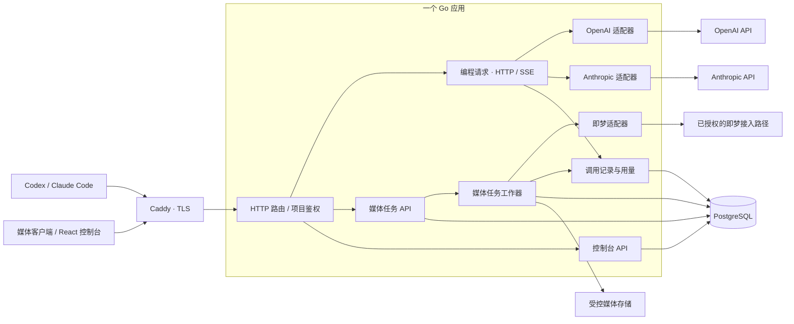
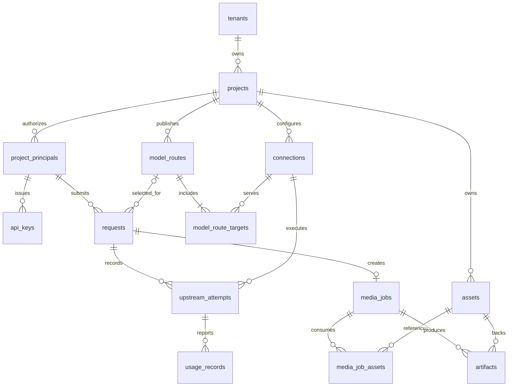

# AI Gateway 实现文档

**状态：目标规格与实现依据。** 当前代码已交付可运行的单实例网关，包含受控故障切换、按能力开启的视频恢复、签名游标、保留清理、历史路由重发、媒体预览和内部积分试算。已实现范围、运行步骤和待验收事项以项目 [README](../README.md) 为准。即梦上游能力与默认容量以实测结果为准。

首发支持 **Codex、Claude Code、即梦图片和即梦视频**，面向需要同时接入编程工具与媒体生成的团队。开发者从项目控制台获取配置并验证调用，创作者提交任务并取回成品，管理员能按请求 ID 定位问题。新项目使用 **Go + React + TypeScript + PostgreSQL**，自行实现网关、任务系统和项目控制台。即梦现有服务用于迁移兼容，并提供已验证的模型规格和任务回放样本。

**P0 交付可独立验证的三条接入路径，P1 交付给团队使用的完整产品。** 首发采用组织授权或自带凭证，显示实际用量和来源。钱包、在线支付、多实例和新增供应商在 P2 按实际需求立项。首发 CLI 使用已验收的 HTTP/SSE 工作流，其他传输和跨协议转换按客户端需求增加。

## 1. 架构决定

**共用一个管理面，采用两条执行链。** 编程请求是实时 HTTP/SSE，代理的首要职责是保持原生事件、工具调用和取消语义。即梦图片和视频统一提交成可查询的媒体任务，任务在客户端断线或应用重启后能继续推进。两类执行链共用项目、API Key、模型目录、上游连接、权限和用量视图，各自管理并发、状态和失败恢复。

采用一个 Go 模块化单体、一套 React 控制台、一套 PostgreSQL。首发 Docker Compose 运行 Caddy、应用和 PostgreSQL。媒体后台工作器在 Go 进程中领取持久化任务，编程请求在同一进程中流式转发。需要部署第二个应用实例时，再引入跨实例的编程并发协调和共享对象存储。



| 代码模块 | 职责 |
| --- | --- |
| `internal/access`、`internal/catalog` | 管理项目、成员、密钥、模型、连接及授权。提供入口鉴权和版本化路由。 |
| `internal/coding` | Responses 与 Messages 的入口、SSE、客户端取消、重试策略和编程并发。 |
| `internal/media` | 素材、任务、幂等、状态机、持久化工作器和成品交付。 |
| `internal/upstream/{openai,anthropic,jimeng}` | 管理各自协议的上游调用、错误归类和可观测用量。适配器通过明确的能力声明接入。 |
| `internal/metering`、`internal/console` | 记录逻辑请求、上游尝试和用量。为 React 控制台提供接入、排障与管理接口。 |

编程适配器实现 `Forward`，返回原生响应流和受理信息。媒体适配器实现 `Submit` 和适用的 `Poll`。`Submit` 可返回即时成品、可查询的上游任务或受理未知，足以覆盖同步图像接口和异步视频接口。额度查询与上游取消按已验证能力开放。新增同类模型主要通过配置注册，新增执行类型需要单独的协议和状态设计。

### 新仓库的代码目录

```text
ai-gateway/
├── backend/
│   ├── go.mod
│   ├── cmd/gateway/main.go          # 启动 HTTP 服务、工作器与优雅退出
│   ├── cmd/gatewayctl/main.go       # 数据库迁移和首个管理员初始化
│   ├── internal/
│   │   ├── app/                     # app.go、routes.go、ui/embed.go
│   │   ├── access/                  # auth.go、postgres.go
│   │   ├── catalog/                 # routes.go、postgres.go
│   │   ├── coding/                  # http.go、forward.go、stream.go
│   │   ├── media/                   # http.go、jobs.go、worker.go、assets.go、postgres.go
│   │   ├── upstream/
│   │   │   ├── openai/client.go     # Codex 对应的 OpenAI Responses
│   │   │   ├── anthropic/client.go  # Claude Code 对应的 Messages
│   │   │   └── jimeng/client.go     # 即梦图片、视频提交和查询
│   │   ├── metering/                # usage.go、postgres.go
│   │   ├── console/http.go
│   │   └── platform/                # PostgreSQL 连接、加密、文件存储
│   ├── migrations/                 # 版本化 PostgreSQL SQL
│   └── tests/                       # integration/、fixtures/
├── frontend/
│   ├── package.json
│   ├── vite.config.ts
│   └── src/
│       ├── main.tsx
│       ├── app/                     # 会话、项目布局、路由和 Query Client
│       ├── features/                # setup/、media/、requests/、usage/、admin/
│       ├── components/              # 表格、表单、任务状态等共用组件
│       └── api/                     # 类型、请求客户端与统一错误解析
├── deploy/compose.yaml
├── deploy/Caddyfile
├── Dockerfile
└── README.md
```

- **编程链**从 `coding/http.go` 经 `forward.go` 调用 OpenAI 或 Anthropic 适配器。`stream.go` 转发原生事件，`metering` 记录请求和上游尝试。项目权限与模型映射分别由 `access`、`catalog` 提供。
- **媒体链**从 `media/http.go` 调用 `jobs.go` 持久化任务。`worker.go` 通过 `media/postgres.go` 领取任务，调用即梦适配器，并保存状态与成品。查询请求直接读取持久状态。
- **依赖方向**由 `app` 装配具体实现。调用方 `coding` 和 `media` 定义需要的适配器接口。各业务模块维护自己的 SQL，`platform` 只提供连接、加密和文件读写等基础能力。控制台通过业务服务查询或修改状态。

开发时 Vite 将 API 请求转发到 Go。生产构建先生成 `frontend/dist`，再将产物复制到 `backend/internal/app/ui/dist`，由 Go 嵌入二进制。Go 只在 `/app` 前端路由范围内回退到 SPA 的 `index.html`，API 路径仍返回相应协议的响应。Dockerfile 从仓库根目录构建，两端随同一应用镜像发布。 [React 构建选型](https://react.dev/learn/build-a-react-app-from-scratch) · [Vite 构建指南](https://vite.dev/guide/)

目录树是目标布局。P0 从 `cmd/gateway`、三类路由、适配器、媒体任务持久化和相应测试起步，同时固定控制台 API 契约。React 控制台随 P1 的接入、交付和排障流程上线。

## 2. 三条接入路径

| 产品 | 对外入口 | 首发范围 |
| --- | --- | --- |
| Codex CLI | `POST /openai/v1/responses`，`GET /openai/v1/models` | 通过自定义 Provider 指向 `https://gateway.example.com/openai/v1`，使用 `wire_api = "responses"` 和网关 Bearer Key。上游使用获授权的 OpenAI API 凭证。首发验收 HTTP/SSE、工具闭环和用完整上下文续轮。客户端使用自定义模型别名时，验证实际版本的 Codex 目录。 [Codex 网关兼容规范](https://learn.chatgpt.com/docs/enterprise/gateway-compatibility) · [模型目录配置](https://learn.chatgpt.com/docs/enterprise/roll-out-a-gateway) |
| Claude Code CLI | `POST /anthropic/v1/messages`、`POST /anthropic/v1/messages/count_tokens`，`GET /anthropic/v1/models` | `ANTHROPIC_BASE_URL=https://gateway.example.com/anthropic`，客户端通过 `ANTHROPIC_AUTH_TOKEN` 发送网关 Key，上游使用获授权的 Anthropic API 凭证。首发验收 SSE、工具回传、计数与启用的缓存、思考能力。 [Claude Code 网关协议](https://code.claude.com/docs/en/llm-gateway-protocol) · [客户端连接](https://code.claude.com/docs/en/llm-gateway-connect) |
| 即梦 | `POST /media/v1/assets`、`POST /media/v1/jobs`、`GET /media/v1/jobs/{id}`、`GET /media/v1/jobs/{id}/artifacts/{artifact_id}` | 首发验证一种文生图和一种视频生成，再按已验证规格增加参考图、首帧等能力。现有调用方可在原即梦服务继续使用 `/v1/images/*` 和 `/v1/videos*`，新客户端用统一媒体任务接口。 [现有模型 API](../../jimeng-api/docs/models-api.md) · [现有视频状态与规格](../../jimeng-api/docs/video-task-design.md) |

首发用经确认的 API 或组织凭证，网关 Key 只负责项目鉴权。即梦需要先确认可用的接入授权和账号权益。若现有即梦服务的接入已获对应授权，可将它作为仅即梦使用的私有迁移适配器，等新实现通过回放和真实验收再迁移流量。火山方舟也有官方 Seedance API，若用它供应相应模型，应在目录标明实际来源，并用独立的模型映射、账号和计量。即梦原功能、模型和积分的兼容情况以实际验收为准。 [火山方舟 Seedance 任务接口](https://docs.volcengine.com/docs/ark/create-video-generation-task-api?lang=zh)

### HTTP 契约与身份

| 入口 | 身份 | 响应约定 |
| --- | --- | --- |
| `/openai/v1/*` | `Authorization: Bearer <gateway-key>` | 保持 OpenAI JSON 与 SSE 协议。`GET /models` 只返回已授权模型，Codex 别名目录按客户端版本单独验证。 |
| `/anthropic/v1/*` | `Authorization: Bearer` 或 `x-api-key`。两者同时出现且值冲突时拒绝。 | 保持 Anthropic JSON 与 SSE 协议。`GET /models` 和 `count_tokens` 按各自契约返回。 |
| `/media/v1/*` | `Authorization: Bearer <gateway-key>` | JSON 任务协议及经授权的二进制上传、下载。 |
| `/console/v1/*` | 同源、服务端会话。修改操作还需 CSRF 校验。 | JSON 控制台 API。业务模块按项目鉴权，同一服务处理 API 和网页发来的媒体任务。 |
| `/livez`、`/readyz` | 供容器和反代使用 | `livez` 检查进程，`readyz` 检查数据库与发布状态。上游故障在连接详情显示。 |

所有响应包含服务端生成的 `X-Request-Id`，上游响应头中的供应商请求 ID 另行记录。鉴权成功的调用可用此 ID 查询授权范围内的摘要。网关自己的媒体和控制台错误使用 `{"error":{"code":"...","message":"...","request_id":"..."}}`。编程入口按原生错误格式映射，流开始后遵循第 3 节。媒体与控制台列表使用 `limit` 和不透明 `cursor`，服务端按 `created_at DESC, id DESC` 排序并返回 `next_cursor`。按项目和过滤条件验证游标，默认 50 条，最大 100 条。

Key 权限按操作授予，首版使用 `coding:invoke`、`media:submit`、`media:read`、`models:read`。Key 的权限取配置与主体当前权限的交集。控制台的项目管理员通过角色维护成员、路由和连接。API Key 明文只在创建时经 TLS 返回，存储随机令牌的 HMAC 摘要与唯一公开前缀，凭证比对在服务端执行。上游凭证由连接分开管理，按授权的主机、地区和路径出站。

### 首次接入配置样例

以下配置采用固定测试模型。测试时将占位模型替换为目录中的真实 ID，并在启动客户端的环境中设置 `GATEWAY_KEY`。Codex 使用别名时，交付匹配所支持客户端的模型目录。 [Codex 配置与目录](https://learn.chatgpt.com/docs/enterprise/roll-out-a-gateway) · [Claude Code 连接配置](https://code.claude.com/docs/en/llm-gateway-connect)

```toml
model_provider = "team-gateway"
model = "APPROVED_OPENAI_MODEL"

[model_providers.team-gateway]
name = "Team Gateway"
base_url = "https://gateway.example.com/openai/v1"
env_key = "GATEWAY_KEY"
wire_api = "responses"
supports_websockets = false
```

```sh
export ANTHROPIC_BASE_URL=https://gateway.example.com/anthropic
export ANTHROPIC_AUTH_TOKEN="$GATEWAY_KEY"
```

## 3. 编程请求的热路径

1. 从 Key 解析租户、项目、主体和权限，校验入口、模型、能力和请求上限，再取对应连接和并发名额。按上游项目或组织聚合共用额度，在发送前持久化本次调用与尝试的开始状态、模型映射和配置版本。SSE 增量直接转发，数据库写入集中在尝试开始和结束。
2. 转发原生协议。只处理路由和安全所需字段，保留工具 ID、事件顺序、未知扩展以及模型需要的推理或缓存字段。Claude 路径保留 `anthropic-version`、完整 `anthropic-beta` 和 thinking 签名对应的内容。仅允许已发布的路径与操作，出站凭证由适配器注入。 [Claude Code 协议细节](https://code.claude.com/docs/en/llm-gateway-protocol) · [Responses 流式事件](https://developers.openai.com/api/docs/guides/streaming-responses)
3. 逐事件刷新 SSE，设置首包、空闲和写入时限，慢客户端走有界缓冲。客户端离线或主动取消时传播到上游并释放并发。接入 Caddy 后验收真实刷新与断开传播。 [Caddy 流式反代](https://caddyserver.com/docs/caddyfile/directives/reverse_proxy#streaming)
4. 只有明确未受理且尚未向下游提交响应时，才在同模型、同权限和同数据区域尝试备用连接。上游可能受理时记录为待核验。响应已开始时保留原生错误事件或结束流。每次上游尝试独立记账，取消后仍可能收到上游实际用量。

首发按完整上下文续轮验收。远程压缩、`previous_response_id` 和 WebSocket 按实际客户端工作流逐项测。任何启用的上游状态引用都须校验项目及主体所有权，并绑定原上游作用域。上游连接内的状态按上游重连语义处理。 [Responses 对话状态](https://developers.openai.com/api/docs/guides/conversation-state)

| 故障时点 | 网关行为 |
| --- | --- |
| 准入阶段 | Key、模型或参数错误返回入口协议的 4xx。项目并发超限返回 429。权限或准入依赖不可用时返回 503。已知限速恢复时间时才返回 `Retry-After`。 |
| 上游已收到请求或受理情况未知，尚未发出下游响应 | 返回协议对应的错误。该尝试记录受理状态和用量来源，并保留可用的上游请求 ID 供后续核验。备用连接只用于有证据表明上游未执行的请求，上游 SDK 自动重试由网关统一控制。 |
| 下游已收到响应头或开始流式输出 | 按协议转发错误事件或结束流，并标记断流。成功以收到原生成功终态为准。 |
| 客户端取消 | 本地标记 `client_canceled`、取消上游连接并释放流式名额。上游是否已停止生成或计费单独记录。 |

### 编程执行器实现顺序

1. `coding/http.go` 验证方法、内容类型、JSON 大小和单一 `model` 字段。其他原生字段采用原始 JSON 保留，模型别名由适配器局部改写。清除入站的网关 Key、内部标头和逐跳标头，再按路由注入上游凭证。为每个上游复用各自的 `http.Transport`。
2. `coding/forward.go` 按项目和上游额度域申请并发名额。P0 每条路由使用一个连接，P1 可配置同区域、同模型能力的有序候选连接。发出请求前写入请求和尝试。只在明确未执行、下游头未发出且仍有剩余时间时，最多尝试一个预先配置的候选。网络写入状态不明确时按可能受理处理。
3. `coding/stream.go` 验证上游状态和内容类型，按 SSE 帧透传并刷新。旁路解析允许的终态与用量字段，保持多行 `data`、未知事件及工具参数增量。非流式响应按上游 JSON 返回，校验载荷大小；流式承诺之后靠原生事件或断流报告失败。成功终态按各协议定义，同时检查响应内状态，EOF 作为正常结束需要已有合法终态。
4. 用独立、短时限的收尾上下文持久化尝试结果、逻辑请求状态和已有用量。上游连接关闭后释放并发名额，收尾写入失败可在后续巡检中识别长期无终态的尝试。该类记录标记未知，由运营核验用量。请求量指标只数逻辑调用，上游用量按尝试记录。

## 4. 媒体任务与成品

### 客户端契约

`POST /media/v1/jobs` 接受 `model`、`operation`、`prompt`、可选素材 ID 和模型规格。`operation` 首发用 `image.generate` 与 `video.generate`。同一模型在目录中公布实际支持的操作、素材类型、尺寸、画幅和时长。提交持久化后返回 `202` 和任务 ID。轮询读取数据库的最新状态，后台统一查上游，避免每个客户端轮询都触发一次上游请求。用户重试提交时使用 `Idempotency-Key`。

| 方法与路径 | 请求与回包 |
| --- | --- |
| `GET /media/v1/models` | 返回已授权模型、可执行操作与参数约束。按 `operation` 可选过滤。 |
| `POST /media/v1/assets` | 单个 multipart `file`，先校验大小、内容类型和实际文件。返回 `201` 和 `asset_id`、`mime_type`、`byte_size`。 |
| `POST /media/v1/jobs` | `202` 新任务，`200` 幂等重放，`409 idempotency_conflict` 同键不同输入。响应 `Location` 指向任务查询地址。 |
| `GET /media/v1/jobs`、`GET /media/v1/jobs/{id}` | 返回可见任务或单次状态。列表可按 `status`、`operation` 和时间范围筛选。 |
| `GET /media/v1/jobs/{id}/artifacts/{artifact_id}` | 已获授权的二进制文件，支持视频 Range 下载。未找到资源返回 `404`。 |
| `POST /media/v1/jobs/{id}/cancel` | P1 支持 `queued` 任务，成功或重复取消返回 `200`。提交已开始时返回 `409 job_not_cancelable`。 |

`image.generate` 的最小请求见下。模型 ID 由项目目录分配。视频使用 `video.generate`，可带 `spec.aspect_ratio`、`spec.duration_seconds` 以及带 `role` 的 `inputs`。服务端拒绝未公布的参数及素材角色。能力允许时，`inputs` 中的项为 `{"asset_id":"…","role":"first_frame"}` 或 `reference_image`。规范化摘要包含所有显式输入与素材顺序。

```json
{
  "model": "jimeng-image",
  "operation": "image.generate",
  "prompt": "一只坐在窗边的橘猫",
  "spec": { "aspect_ratio": "1:1" }
}
```

```json
{
  "id": "70883773-3d7a-4b6c-82ae-34cc15812f67",
  "request_id": "2642bb26-da68-4a7e-9bc4-35c2f49327ce",
  "model": "jimeng-image",
  "operation": "image.generate",
  "status": "queued",
  "artifacts": [],
  "updated_at": "2026-11-26T08:00:00Z"
}
```

以租户、项目、稳定的调用主体、操作和幂等键为唯一约束。同一个项目服务主体轮换 Key 后仍使用同一幂等域。请求摘要基于规范化的客户端输入，包括模型、显式规格和不可变素材 ID。执行所用默认值与路由单独随任务保存，配置更新后重放原请求仍命中原任务。相同键与相同输入返回原任务，同键不同输入返回 `409`。对无幂等键的请求，每次提交创建独立任务。任务、初始状态和鉴权后的素材引用在同一事务中提交。重复提交成功返回原任务当前状态，提交响应通过 `Location` 指向查询地址。幂等记录至少保留至任务终结及公开的客户端重试窗口结束，未决任务保留记录直至复核结束。

`GET /media/v1/jobs/{id}` 返回 `id`、`status`、`updated_at` 和可用成品列表，失败时附可机读的 `error.code`。进度缺失时省略 `progress`，只有成品可交付时达到 100%。创建、查询和下载都要校验当前项目权限，任务或成品归属不符时返回 404。排队取消如需对外开放，以条件更新和工作器的领取操作竞争，先成功的一方决定该任务是否开始提交。

### 状态与恢复

| 状态 | 处理规则 |
| --- | --- |
| `queued` | 可由工作器领取。创建时记录用于提交的模型与路由版本，领取时按当前授权和连接状态复核。实际连接随首次尝试落库。 |
| `submitting` | 发送前持久化尝试和关联 ID。工作器在短事务里取得有时限的租约，出站调用在事务外执行。 |
| `running` | 已有可追踪的上游回执。后台按 `run_after` 退避查询，保持同一连接及授权作用域。 |
| `submit_unknown` | 网络或进程故障导致受理未知。有可信关联 ID 时对账查原任务，只有上游能证明未受理或具备已验证的幂等契约时才可重发。找不到原任务时进入人工复核，保留发起新任务的独立操作。 |
| `finalizing` | 已看到上游完成或同步成品，验证产物类型、大小及可读性后交付。仅重试取回或保存产物。排队封面保留作预览。 |
| `succeeded` / `failed` / `canceled` | 成品确认可读后成功。明确的错误才进入失败。排队任务可本地取消，已受理任务在上游确认取消后标记为取消。 |

工作器以 `FOR UPDATE SKIP LOCKED` 批量领取到期任务，在短事务中写入租约和递增版本。续约、状态更新和成品挂载都以当前租约版本为条件。过期的查询和成品保存可以重做，过期的 `submitting` 进入 `submit_unknown`。数据库只能约束本地写入，外部提交安全依赖上游查询、明确的拒绝或上游幂等契约。复核超时后保留待处理原因供运维处理，自动查询预算和频率有上限。 [PostgreSQL SELECT](https://www.postgresql.org/docs/current/sql-select.html) · [已有视频任务状态设计](../../jimeng-api/docs/video-task-design.md) · [现有任务存储](../../jimeng-api/src/lib/video-task-store.ts)

媒体文件和输入素材放在私有持久卷，PostgreSQL 保存归属、校验信息和保留期。对象先落到持久存储，再登记素材或在同一个数据库事务中挂载成品并完成任务。数据库写入失败时留下的孤立文件由后台按保留窗口清理。清理任务检查活跃引用，阻止待处理任务的素材被提前删除。下载经项目权限校验，使用网关授权下载或对象存储短期签名。首发接收上传或本项目的素材 ID，出站下载限制到经过审核的上游媒体地址。多实例切换到兼容 S3 的对象存储，保留相同的任务 API。

### 工作器事务和恢复边界

| 步骤 | 事务、状态与外部操作 |
| --- | --- |
| 1. 创建任务 | 锁定项目的入队额度记录或项目行，先查幂等命中，再校验新增任务上限。单事务写 `requests`、`media_jobs` 和素材引用。当前授权复核后，重放读取原任务。 |
| 2. 领取提交 | 按项目公平选取 `run_after` 到期任务，短事务锁定一批，写 `submitting`、租约版本和上游尝试及提交关联号。领取前核对项目、主体、模型和连接仍可用，执行参数仍取任务创建时的版本。数据库提交后才请求上游。 |
| 3. 处理结果 | 以当前租约版本条件更新。明确受理后写 `accepted_attempt_id` 和上游任务 ID，进入 `running`。即时成品先持久化临时对象并登记交付引用，进入 `finalizing`。明确拒绝按原因终止或由策略排队重试，受理未知进入 `submit_unknown`。 |
| 4. 查询与核验 | `running` 只用原受理连接查询，写下次 `run_after`。`submit_unknown` 先查原关联号或按已验证的幂等契约恢复。无可靠查询能力时停止自动提交，进入人工核验。连接授权失效时保留原绑定及错误原因。 |
| 5. 交付 | 用稳定的成品位置键区分预览与最终文件。每次文件写入生成独立的不可变对象键，持久化后用单事务挂载成品、记用量及更新 `succeeded`。租约失效的工作器只能留下待清理的孤立对象。只有可读最终文件能使任务成功。暂时取件失败只重试交付。超过交付时限后记录 `result_unavailable`，保留上游受理和用量事实。 |

所有上游调用在事务外执行。租约续期或写回失败时停止本地处理。租约超时后可重复查询和拉取成品，提交记录须先核验。临时文件由同一文件系统内的原子替换迁入对象路径，清理使用宽限期并排除正在处理或有数据库引用的对象。首发对每种即梦接入方式记录能否查提交号、成品 URL 有效期和实际计量字段。未验证的能力在模型目录中关闭。

## 5. 共用控制面与用量

| 项目 | 首发设计 |
| --- | --- |
| 权限和凭证 | `tenants`、`projects`、`project_principals`、`api_keys`、`connections`。Key 仅保存摘要和范围，撤销由服务端执行。上游凭证加密，管理端显示摘要与验证时间。在当前项目权限范围内校验任务、素材、模型和调用日志。 |
| 调度 | 每个产品按授权连接和真实模型路由。编程流、媒体提交、媒体轮询各有并发上限和连接池。媒体入队在事务内约束项目待处理数量，工作器分别限制准备提交与上游在途任务，按项目公平领取。单实例用进程内编程限流，媒体任务和租约由数据库协调。 |
| 核心数据 | `model_routes` 记录模型、能力及路由版本，`requests` 和 `upstream_attempts` 关联编程请求、媒体任务和实际尝试，`media_jobs`、`assets` 和 `artifacts` 记录媒体生命周期。`usage_records` 关联实际操作和用量来源，`audit_events` 记录连接、密钥和路由变更。 |
| 用量 | Codex 和 Claude 按各自 Token 字段计量。即梦记录任务数及可获取的原生用量或积分。账号余额差是账号级观测，模型任务缺少明确用量时标记估算或待核验。集中展示请求与任务信息，金额换算以已确认的计量和价格规则为准。 [当前积分统计实现](../../jimeng-api/src/api/controllers/generation-credits.ts) |
| 收费 | 首发采用团队自带或组织授权凭证，展示用量和预算。商业化时增加版本化价格、额度预留、幂等扣款和对账，独立存储上游成本与客户账单。 |
| 运维 | 记录请求或任务 ID、失败阶段、首输出延迟、编程流中断率、媒体队列深度、轮询延迟和未确认提交数。日志按权限查询，只保存脱敏元数据。首发备份 PostgreSQL、资产和恢复所需密钥，做一次恢复演练。 |

数据库关联带上租户和项目范围。资源读取先确认当前主体权限，再按范围查找。连接或模型被停用时拒绝新调用，已受理的媒体任务使用原绑定查询。若原绑定因凭证撤销失去访问权，进入待处理状态，由运维恢复原账号授权。用户 Key 和上游密钥分别签发与轮换，只有对应适配器在发起请求时取用上游密钥。

用量记录按逻辑请求或任务关联上游尝试。流中累计值按协议取最新观测值，每个尝试只入账一份同来源、同维度的终态用量。网关观测的调用次数、上游提供的实际用量、估算和缺失字段独立显示。后台更正带原记录引用和审计信息，便于后续账本对账。

可复用 Go `net/http`、官方 API SDK、`pgx`、`goose` 和一套 React UI 组件。编程原生路径用 HTTP 传输和有界事件解析，官方 SDK 可用于辅助接口和测试。现有即梦仓库优先复用脱敏响应样本、规格校验用例和经过验证的工作流，按新接口实现持久任务与权限。 [Go HTTP](https://pkg.go.dev/net/http) · [OpenAI Go SDK](https://github.com/openai/openai-go) · [Anthropic Go SDK](https://github.com/anthropics/anthropic-sdk-go) · [pgx](https://github.com/jackc/pgx) · [goose](https://github.com/pressly/goose)

## 6. PostgreSQL 表结构

数据库以**项目作为权限边界，调用主体作为身份，逻辑请求作为用量归因入口**。一个 Responses 或 Messages 调用生成一条 `requests`。一个图片或视频任务也生成一条 `requests`，并与 `media_jobs` 一对一关联。同一逻辑请求可有多条上游尝试。媒体状态以 `media_jobs` 为准，`requests.status` 仅维护编程请求状态，媒体请求详情通过关联查询获得状态。



### 身份、连接和路由

| 表 | 关键字段 | 约束 |
| --- | --- | --- |
| `tenants`、`projects` | `id`、`name`、`status`，项目额外有 `tenant_id` | 一个租户有多个项目。停用项目时阻止新调用。 |
| `users`、`project_principals` | 用户含 `id`、`email_norm`、`password_hash`、`disabled_at`。主体含 `id`、`tenant_id`、`project_id`、`kind`、`user_id`、`role`、`disabled_at` | 人员主体通过唯一的规范化邮箱登录，并在每个项目有一个主体。服务主体按项目创建。项目角色和服务主体身份独立于 Key。 |
| `web_sessions`、`project_invitations` | 会话含 `user_id`、`token_digest`、`expires_at`、`revoked_at`。邀请含项目、受邀邮箱、角色、令牌摘要、有效期及使用时间 | P1 采用邀请加入项目。邀请单次使用，确认身份后同一事务创建成员关系并消费邀请。会话只认证用户，授权按当前项目关系读取。 |
| `api_keys` | `id`、`principal_id`、`key_prefix`、`key_digest`、`digest_key_id`、`scopes`、`expires_at`、`revoked_at` | Key 通过摘要和状态校验，项目和主体由外键约束。轮换 Key 继续使用原主体 ID，P1 默认在同一事务中签发新 Key 并撤销旧 Key。 |
| `connections` | `id`、`provider`、`label`、`quota_scope`、`status`、`region` | 首发连接归项目所有。相同上游额度域共用限流计数。 |
| `connection_secrets` | `connection_id`、`version`、`key_id`、`ciphertext`、`created_at` | 每个连接的凭证版本唯一。只有适配器在出站时取得所需凭证。 |
| `model_routes` | `id`、`protocol`、`operation`、`public_model`、`capabilities`、`version`、`is_active` | 每个项目的协议、操作、公开模型仅一个生效版本。发布时在同一事务中写入新版本和目标、切换生效标识。历史版本用于已受理任务和调用排障。 |
| `model_route_targets` | `route_id`、`position`、`connection_id`、`upstream_model` | `UNIQUE(route_id, position)`。P0 每条路由仅一个目标。P1 的备用目标和首选处于同一项目，并满足同模型、协议、授权和数据区域约束。 |

### 请求、媒体和用量

| 表 | 关键字段 | 约束 |
| --- | --- | --- |
| `requests` | `id`、`principal_id`、`api_key_id`、`route_id`、`kind`、`operation`、`requested_model`、`status`、`failure_stage`、`error_code`、`created_at`、`finished_at` | `id` 也是调用方可复制的网关请求 ID。保存归属和路由版本。已识别主体的准入失败可保存摘要，未选路时 `route_id` 为空。编程请求记录自己的终态，媒体任务详情关联 `media_jobs` 取得。无法认证的调用进入脱敏安全日志。 |
| `upstream_attempts` | `id`、`request_id`、`attempt_no`、`connection_id`、`provider_request_id`、`submission_key`、`upstream_model`、`acceptance_state`、`result`、`upstream_status`、`first_output_at`、`started_at`、`finished_at` | `UNIQUE(request_id, attempt_no)`。`submission_key` 用于媒体上游已验证的查询或幂等契约。网关请求 ID 与上游请求 ID 分开保存。`first_output_at` 以第一个有效内容或工具事件为准。媒体轮询更新原任务进度。 |
| `media_jobs` | `id`、`request_id`、`principal_id`、`operation`、`idempotency_key`、`input_hash`、`execution_input`、`status`、`accepted_attempt_id`、`upstream_job_id`、`progress`、`last_error_code`、`run_after`、`lease_until`、`lease_version`、`created_at`、`updated_at` | `request_id` 唯一，关联的受理尝试属于同一请求。`execution_input` 保存执行所需规格与受控访问的提示词，任务结束后按保留策略清除敏感输入。查询上游任务时使用受理尝试对应的连接。 |
| `assets`、`media_job_assets`、`artifacts` | 素材含 `id`、`owner_principal_id`、`object_key`、`mime_type`、`byte_size`、`content_hash`、`expires_at`。关联表记录 `job_id`、`asset_id`、`role`、`position` | 素材与成品使用同一物理对象元数据模型。引用与成品绑定在所属项目内。`artifacts` 按 `(job_id, role, position)` 唯一，分别标记预览和可下载成品。 |
| `usage_records` | `attempt_id`、`metric`、`unit`、`quantity`、`source`、`observed_at` | 同一尝试的计量维度、单位与来源唯一。估算与实际可以同时保存，默认汇总优先取实际。小数积分使用定点 `numeric`。账号余额快照与单请求计量使用独立口径。 |
| `audit_events` | `id`、租户和项目范围、`actor_id`、`action`、`target_id`、`created_at`、`metadata` | 追加记录授权、Key、路由、手工核验等变更。只写允许的脱敏字段。 |

### 首批约束和索引

- 项目内的表含 `tenant_id` 和 `project_id`。父表声明对应的复合唯一键，子表用复合外键约束任务、素材、请求、主体、路由和连接属于同一项目。查询同时带上当前项目范围。 [PostgreSQL 外键与唯一约束](https://www.postgresql.org/docs/current/ddl-constraints.html)
- `media_jobs` 设部分唯一索引 `(tenant_id, project_id, principal_id, operation, idempotency_key)`，只覆盖提供了幂等键的请求。创建逻辑请求和媒体任务使用同一事务，幂等冲突返回原任务并比较 `input_hash`。 [PostgreSQL 部分索引](https://www.postgresql.org/docs/current/indexes-partial.html)
- 媒体任务按可处理状态和 `run_after` 建领取索引，按 `lease_until` 建活跃租约恢复索引。提交、查询、复核和成品交付都用 `run_after` 表示下次可领取时间。`requests` 按 `(tenant_id, project_id, created_at, id)` 建控制台分页索引。任务状态、用量和日志过滤的附加索引按实际查询验证。

### 迁移与事务实现

业务 ID 使用 UUID，时间用 `timestamptz`，持续时间用毫秒，文件大小用 `bigint`。`jsonb` 用于模型能力和任务参数等可版本化结构。归属、状态、关联、领取时间和用量单位使用类型化列。用 `CHECK` 限定状态和值域。编程请求终态使用 `succeeded`、`failed`、`client_canceled` 或 `interrupted`，媒体请求状态从 `media_jobs` 读取。尝试的受理状态用 `unknown`、`not_accepted` 和 `accepted`，与结果字段分别更新。`media_jobs.progress` 可空，取 0–100，只有成功状态为 100。

| 迁移文件 | 内容和依赖 |
| --- | --- |
| `00001_identity.sql` | 租户、项目、用户、主体与 Key。建复合项目键与唯一身份约束。 |
| `00002_catalog.sql` | 连接、凭证版本、路由版本和目标。对生效路由建部分唯一索引。 |
| `00003_execution.sql` | 请求、尝试、素材、任务、素材引用和成品。建立任务外键、幂等、领取、恢复、分页约束。 |
| `00004_observability.sql` | 用量与审计。创建上游请求追踪索引，验证真实查询后补充额外索引。 |
| `00005_console_auth.sql` | P1 增加浏览器会话与项目邀请。 |

迁移通过 `gatewayctl migrate up` 在部署时执行。每次验证由空库和上一个发布版本正常升级。新字段先可兼容读写，再回填和加约束。结构变更遵循可回退发布所需的兼容窗口。测试环境可重建数据库，生产破坏性变更通过独立迁移评审和恢复计划上线。

下列 SQL 明确幂等索引和租约写回条件。提交事务在冲突时回滚整笔创建，随后读取并校验原任务。领取方在锁定的同一事务内递增 `lease_version`，持有者只能在租约仍有效且版本匹配时更新，影响零行代表已失去租约。

```sql
CREATE UNIQUE INDEX media_jobs_idempotency_uq
ON media_jobs (tenant_id, project_id, principal_id, operation, idempotency_key)
WHERE idempotency_key IS NOT NULL;

UPDATE media_jobs
SET status = 'running', accepted_attempt_id = $5, upstream_job_id = $6,
    run_after = $7, updated_at = now(), lease_until = NULL
WHERE tenant_id = $1 AND project_id = $2 AND id = $3 AND lease_version = $4
  AND status = 'submitting' AND lease_until > now();
```

路由发布用同一项目事务完成生效版本切换，已排队任务保持原执行规格，领取前重新核对当前权限。媒体提交关联号与状态在同一事务内记录。带 `accepted_attempt_id` 的媒体任务使用含 `request_id` 的复合外键验证尝试归属。按已接入上游定义稳定的去重维度，避免把不同账号下重名的上游任务 ID 当成一个任务。

### 日志读取和保留

配置、密钥和审计与请求观测各用独立的业务表和查询入口，首发共用 PostgreSQL。日志列表按项目、时间范围、类型和状态过滤，使用 `(created_at, id)` 游标分页，详情按网关请求 ID 查询。用量页初期按有界时间区间聚合，出现明确查询瓶颈后再考虑按日聚合或归档。图片、视频任务的待核验状态继续由任务表维护。

编程请求日志只保存诊断元数据。媒体提示词和素材仅在执行与交付所需的数据范围内保存，与日志导出隔离。按审计、请求与媒体各自的保留策略清理，清理前检查未决任务、素材引用及仍需归因的用量。用量导出至少支持按项目筛选，并标记实际、估算或缺失。

## 7. React 控制台产品设计

### 谁使用，完成什么

| 角色 | 首发任务 | 可访问范围 |
| --- | --- | --- |
| 开发者 | 配置 Codex 或 Claude Code，验证首次请求，按请求 ID 查自己的调用。 | 已加入项目的可用模型、本人有权管理的 Key 及请求。 |
| 媒体创作者 | 选即梦模型、上传素材、查看进度及下载成品。 | 本人资源，以及明确授权读取的项目资源。 |
| 项目管理员与平台运维 | 管理连接、模型和权限，按阶段排查请求与媒体任务。 | 依据角色和授权项目访问用量、审计和诊断字段。 |

### 导航与页面

所有项目页面位于 `/app/projects/:projectId`。项目切换器在各页可用，列表筛选进入 URL，支持刷新、回退及分享给有权限的同事。首页在项目无调用时优先引导接入，有调用后显示最近成功请求与需要处理的任务。

| 页面 | 主要内容和行为 |
| --- | --- |
| 接入与密钥 | 选择客户端、系统、可用模型和 Key。生成配置、复制验证步骤，展示本次接入是否已有符合条件的实际调用。支持创建、停用和轮换 Key。 |
| 媒体任务 | 按模型能力渲染图片和视频表单。任务列表展示排队、生成、交付、待核验和终态，详情提供产物预览与授权下载。 |
| 请求记录 | 默认按最新请求排序。可按产品、模型、状态、时间和网关请求 ID 筛选。详情展示路由版本、失败阶段、上游尝试和时间线。授权运维可查看上游请求 ID。 |
| 用量 | 按项目、产品和时间范围查看调用结果及用量。请求次数、Token、即梦积分分别呈现。用量未知与真实零用量有不同状态，CSV 保持相同口径。 |
| 项目管理 | 管理成员、连接和路由。连接页区分凭证有效性、限流、模型权限与额度未知。记录最近探测时间和配置变更审计。 |

### 三条关键用户流程

1. **CLI 首次接入。** 创建或选择 Key，选 Codex 或 Claude Code，再复制与当前项目、入口和模型匹配的配置。配置默认使用环境变量占位。Key 只在创建时回显。页面通过控制台 API 查验指定 Key、协议和模型在验证开始后的首个真实成功生成请求，模型列表、计数和探活归为各自的操作。失败时提供失败阶段、网关请求 ID 和对应的处理步骤。
2. **即梦生成与取件。** 选择统一目录中已验证的操作和规格，上传素材后提交。页面在本次提交重试时沿用同一幂等键和原输入，刷新后从任务 URL 恢复。`submit_unknown` 时显示正在核验及查询入口。服务确认成品可读后，提供预览与下载。明确失败后，用户可重新发起操作。
3. **请求排障。** 从用户收到的网关请求 ID 跳到详情，先确定鉴权、准入、上游调用、流终态或交付阶段，再查看授权范围内的上游 ID、路由版本、延迟及用量来源。请求与任务互相跳转，媒体预览由资源授权单独控制。

### 前端实现与交付

- 采用 **React + TypeScript + Vite** 的客户端 SPA，使用 React Router、TanStack Query 和一套共用 UI 组件。路由负责项目与页面范围，服务端状态按项目及过滤条件缓存。任务详情在活跃时轮询，终态后停止。选定项目退出登录或权限被收回时清理对应缓存。 [React 路由与数据获取](https://react.dev/learn/build-a-react-app-from-scratch)
- 控制台使用同源 `/console/v1` API。浏览器登录会话与 CLI、媒体客户端的 API Key 独立。浏览器提交媒体任务时，控制台 API 使用当前主体调用同一个媒体服务，沿用项目权限和幂等规则。会话 Cookie 使用 `HttpOnly` 和生产 HTTPS 对应的 `Secure` 属性，对变更请求校验 CSRF，所有资源权限由 Go 核验。页面按权限显示导航和字段。浏览器应用缓存只保留页面所需的元数据，Key 明文仅出现在创建结果中。
- 首发组件覆盖加载、空态、权限不足、上游暂不可用和表单校验。每个状态给出用户能执行的下一步，进度和告警用文字和状态共同表达，支持键盘操作。以接入成功、成品交付及按 ID 找到故障为验收终点。

### 控制台端点与组件落地

以下项目端点均以 `/console/v1/projects/{project_id}` 为前缀。页面路由进入时先读取当前会话，再按项目拉取数据。轮询和后台刷新按查询键隔离，离开项目时取消未完成的请求。

| 页面 / 前端目录 | API 与交付 |
| --- | --- |
| 登录和项目切换 `src/app` | `POST /console/v1/session`、`GET /console/v1/session`、`DELETE /console/v1/session`，`GET /console/v1/projects`。初始管理员由部署命令创建，后续按邀请加入。 |
| 接入与密钥 `features/setup` | `GET /models`，`GET/POST /keys`，`POST /keys/{id}/rotate`、`POST /keys/{id}/revoke`。`POST /setup/checks` 创建与项目、调用主体、Key、协议和模型绑定的短时检查 ID，`GET /setup/checks/{id}` 返回 `waiting`、`succeeded` 或 `failed` 及可见请求 ID，过期返回 `410`。结果按服务端开始时间筛选，出现符合条件的成功生成即标记成功，失败详情取最近一次符合条件的失败。 |
| 媒体 `features/media` | `POST /media/assets`、`GET/POST /media/jobs`，`GET /media/jobs/{id}`、`POST /media/jobs/{id}/cancel`、`GET /media/jobs/{id}/artifacts/{artifact_id}`。使用相同媒体服务和返回结构。上传与提交分别显示状态。 |
| 请求及用量 `features/requests`、`features/usage` | `GET /requests`、`GET /requests/{id}`、`GET /usage` 和 `GET /usage/export`。请求详情带授权后的尝试摘要、关联任务和用量来源。CSV 导出与页面使用同一套过滤及权限。 |
| 项目管理 `features/admin` | `GET/PATCH /members/{id}`、`GET /members`、`GET/POST /invitations`、`POST /console/v1/invitations/accept`。`GET/POST /connections`、`PATCH /connections/{id}`、`POST /connections/{id}/probe`。`GET /routes`、`POST /routes/validate`、`POST /routes/publish` 和 `GET /audit-events`。重发历史版本走发布接口并产生新版本。 |

首发 UI 按正常、无数据、权限撤销、上游暂时不可用和未确认提交这几类情况验收。媒体下载和密钥响应使用防缓存策略。项目成员范围或 Key 状态变化后刷新服务端授权与相关数据，清理旧项目缓存。接入校验凭证只用于轮询结果，不承载业务调用权限。

## 8. 部署与故障边界

- **单实例部署。** 应用进程内为两条执行链配置独立的请求、数据库和工作器预算。数据库不可用时拒绝新的鉴权和媒体写入，媒体工作器停止领取。已开始的流在既有时限内结束，终态写入失败计入独立指标，依据发起记录重新核验。磁盘不足时停止接受新素材和媒体任务，编程入口按自身依赖保持运行。
- **流与任务排空。** 应用退出时先撤出就绪探针并停止领取媒体任务，再在关闭期限内完成已开始的流和可完成的短任务。来不及确认的媒体提交按 `submit_unknown` 恢复。上线时通过 Caddy 实测事件即时刷新与断连取消，尤其验证 `flush_interval -1` 对取消传播的影响。 [Caddy 流式反代](https://caddyserver.com/docs/caddyfile/directives/reverse_proxy#streaming)
- **扩容条件。** 单实例无法满足已测量的并发或可用性目标时，再为编程限流引入共享协调，并切换共享对象存储。媒体任务继续用 PostgreSQL 的领取事务和租约协调。备份恢复时同时核对任务行、加密密钥和实际对象，对照缺失成品与长期孤立对象。

### 运行参数与发布步骤

| 参数 | P0 初始值或配置来源 |
| --- | --- |
| 入口及存储 | `PUBLIC_BASE_URL`、`DATABASE_URL`、`MEDIA_STORAGE_DIR` 必填。连接加密与 Key 摘要各用独立密钥，从部署秘密文件读取并保留密钥版本。 |
| 编程请求 | 首包、流空闲、单次写入以及总时限分别配置。测试环境起点为 60 秒、120 秒、15 秒和 20 分钟，真实上下文和代理链路测完后调整。 |
| 媒体工作器 | 提交、轮询和交付分配独立并发预算。以 45 秒租约、每 10 秒续约作为 P0 起点。按 Provider 的最低轮询间隔加退避与抖动；提交、核验、交付各自有截止时间。 |
| 请求与文件大小 | JSON、上传和成品分别设字节上限。服务器在读取时执行限制，目录为各操作声明允许的素材类型、大小和数量。 |
| 数据库资源 | 编程和媒体使用独立的池或保留连接预算。上限由环境配置，测试媒体积压时的连接等待、流失败率和读写耗时。 |

1. 检查环境变量、密钥及挂载卷，构建 React 静态产物后构建 Go 二进制。应用镜像包含网关和 `gatewayctl`。
2. 启动 PostgreSQL，运行 `gatewayctl migrate up`，P0 用受控初始化命令创建测试租户、项目和第一组 Key。P1 通过初始化命令添加首个管理员，登录后经邀请补充成员。凭证通过秘密文件或受控输入提供。
3. 启动应用和 Caddy，确认就绪探针、媒体存储权限和测试上游连接后开放流量。访问 SPA 深链接、CLI 接口和成品下载验证实际路由。
4. 发布前备份数据库、媒体和密钥。需要同一恢复点时暂停新提交、排空或记录未完成操作后再做备份。旧镜像回退前确认 SQL 结构仍兼容。媒体重启后按数据库状态续跑。

结构化日志与指标至少包含网关请求 ID、产品、操作、失败阶段、首输出耗时、队列年龄、未知提交和租约冲突。项目或请求 ID 用于授权后的日志检索，指标只用低基数标签。P0 建立混合负载、查询延迟和恢复时间基线，P1 依据基线固定告警阈值与容量目标。

## 9. 开发顺序与验收

| 阶段 | 交付 | 通过条件 |
| --- | --- | --- |
| P0 三条最小链路 | 独立仓库骨架、一个测试项目、固定连接和最小路由。跑通 Codex、Claude Code、即梦图片和视频。 | 两个 CLI 分别完成真实 SSE、多轮工具回传与取消。授权即梦账号分别完成一次图片和视频交付。验证同幂等键无重复提交、工作器重启继续原任务、跨项目下载被拒绝。 |
| P1 团队上线 | React 控制台上线接入与密钥、媒体任务、请求、用量、项目管理。按客户端迁移现有即梦调用。 | 真实用户分别通过页面接通两个 CLI 并确认生成请求成功，完成即梦提交、刷新恢复、下载。运维按网关 ID 定位故障阶段。验证项目权限与混合负载。 |
| P2 运营和容量 | 按实际需要增加账本、多实例、高级媒体能力或附加 CLI 能力。 | 上游账单可对账后再启用收费。多实例前验证并发协调、工作器竞争、对象存储及备份恢复。 |

### 开发包与依赖顺序

| 开发包 | 实现位置 | 完成标准 |
| --- | --- | --- |
| 1. 仓库与环境 | `backend/cmd`、`backend/migrations`、`deploy`、`frontend` 脚手架 | 依赖锁定，能从空库迁移。CI 构建前后端并跑一次 Compose 健康检查。 |
| 2. 项目权限与模型目录 | `access`、`catalog`、迁移 1–2 | 租户、项目、主体、Key、连接与路由可初始化和查询。跨项目、Key 撤销、路由版本切换有集成测试。 |
| 3. 两个原生流式入口 | `coding`、OpenAI 与 Anthropic 适配器、`metering` | 依赖开发包 2 和迁移 3–4。模拟上游回放和真实 CLI 工具闭环通过。 |
| 4. 即梦图片和视频任务 | `media`、即梦适配器、迁移 3–4 | 可与流式入口并行开发。持久化任务和三类故障注入通过，使用获授权的即梦连接完成实际图片与视频交付。 |
| 5. React 产品与管理 | `frontend`、`console`、迁移 5 | 在 API 契约确认后分页面开发。浏览器测试覆盖登录、Key、配置、生成、回查、权限和下载。 |
| 6. 上线与迁移 | `deploy`、集成测试、发布记录 | 先完成授权、备份恢复、容量基线与灰度切换演练，再按项目放量。 |

CI 分为 Go 单测、PostgreSQL 集成和浏览器端到端。外部上游用脱敏夹具或可控制的模拟器，覆盖半截 SSE、上游受理后断连、工作器重启、同键异参和成品回执延迟。真实凭证的回归由独立验收环境运行。发布记录保存客户端版本、模型、关键用例结果、上游接入授权和恢复演练结果。

| 必测场景 | 验收结果 |
| --- | --- |
| P1 产品路径 | 记录从进入项目到首次成功生成请求的时长、是否中途放弃及失败阶段。两种 CLI 的探活和模型列表均不会误标接入成功。测试者仅用一个网关请求 ID 即可定位故障。同一媒体提交断线重试和任务页刷新后仍指向同一个任务。 |
| 真 CLI 与协议回放 | 记录 CLI、上游模型和网关版本。工具调用 ID 与工具结果能对应，多轮续聊成功。经 Caddy 可持续收到事件，断线可观察到取消和并发释放。 |
| 媒体提交确认丢失 | 模拟上游已受理、本地回执未保存。重启后按上游回执核验，同一幂等键仍指向原任务，未取得证据前无第二笔上游创建。 |
| 租约过期与产物延迟 | 两个工作器竞争同一任务，只有当前租约可推进状态。上游先返回封面再返回成片时，任务保持生成或交付中，成品可读后才成功。 |
| 租户隔离与密钥撤销 | 用他人项目的任务 ID、素材 ID、成品 ID、日志和模型测试读写权限。撤销 Key 后的新操作全部拒绝，合法主体可按授权追踪已有任务。 |
| 混合负载与恢复 | 固定测试资源、模型以及流并发数，分别记录仅编程流和媒体积压时的网关额外延迟、断流、队列深度。P0 记录基线，在 P1 放量前据此定量化门槛。恢复演练核对原任务、成品和待核验提交。 |

迁移即梦时，旧任务由旧服务继续查询和下载。先按已验证的模型和用户小批切换新任务，旧 API 兼容层仅在盘点确有调用方时实现。回滚时把新提交切回旧服务，已受理任务继续由各自受理的服务完成。用脱敏回放或单独授权的测试任务对照，避免一份生产请求触发两次生成。

文档依据当前工作区的即梦源码、实测记录和所列官方文档。自动化测试覆盖模拟上游的主要路径。三条接入路径的真实联调、即梦接入授权和性能均列为实地验证项。

## 10. GitHub 产品对照与取舍

对照五个公开项目的表定义、存储配置和 UI 源码或官方文档。下表描述抽查路径所能验证的功能范围，版本和部署选项会影响实际表现。Bifrost 引用的是 `dev` 文档。表中建议用于本产品设计评审，UI 交互与性能仍需实际运行验证。

| 项目 | 数据库或存储 | UI 产品路径 | 对本项目的影响 |
| --- | --- | --- | --- |
| **Sub2API** | PostgreSQL，Go Ent 定义账号和用量记录。用量关联调用方、API Key、上游账号和模型。 | Vue 有用户 Key、用量，以及管理端账号、渠道和审计。Key 对话框已提供 Codex、Claude Code 配置，含不同传输和目录处理。 | 参考「建 Key → 按客户端生成配置」，增加真实首次成功提示。 [账号表](https://github.com/Wei-Shaw/sub2api/blob/main/backend/ent/schema/account.go) · [用量表](https://github.com/Wei-Shaw/sub2api/blob/main/backend/ent/schema/usage_log.go) · [前端路由](https://github.com/Wei-Shaw/sub2api/blob/main/frontend/src/router/index.ts) · [配置组件](https://github.com/Wei-Shaw/sub2api/blob/main/frontend/src/components/keys/UseKeyModal.vue) |
| **LiteLLM** | PostgreSQL + Prisma，团队和虚拟 Key 与 `SpendLogs` 分开。日志以请求 ID 为主键，可按 Key 归因。 | 管理 UI 有请求日志及保留设置。提示词和响应体默认关闭存储，可显式开启。 | 采用项目级元数据排障和可配置的保留策略。即梦执行输入另存于任务数据。 [Prisma 表结构](https://github.com/BerriAI/litellm/blob/main/litellm/proxy/schema.prisma) · [日志 UI](https://docs.litellm.ai/docs/proxy/ui_logs) · [保留设置](https://docs.litellm.ai/docs/proxy/ui_spend_log_settings) |
| **Bifrost** | 配置与请求日志使用独立存储接口。配置可用 SQLite 或 PostgreSQL，日志支持 SQLite、PostgreSQL 或 ClickHouse。 | React 管理端有实时日志、筛选、详情、Provider 配置和延迟分析。 | 同一 PostgreSQL 内隔离配置与观测查询。首发提供可筛选列表和请求详情，实时推送和独立日志存储按使用量再评估。 [存储配置](https://github.com/maximhq/bifrost/blob/dev/docs/deployment-guides/config-json/storage.mdx) · [UI 说明](https://github.com/maximhq/bifrost/blob/dev/ui/README.md) |
| **New API** | GORM 定义渠道、Token 和日志。日志记录网关及上游请求 ID。主库支持 SQLite、MySQL、PostgreSQL，可单独配置日志库。 | React 运营后台按功能组织 Dashboard、渠道、密钥、用量及运营功能。 | 保留双请求 ID 方便客服和上游排查。首发专注接入、运行和用量，计费运营页等收费成为正式功能再加入。 [数据模型](https://github.com/QuantumNous/new-api/tree/main/model) · [日志源码](https://github.com/QuantumNous/new-api/blob/main/model/log.go) · [前端功能目录](https://github.com/QuantumNous/new-api/tree/main/web/src/features) · [部署说明](https://github.com/QuantumNous/new-api/blob/main/README.en.md) |
| **CLIProxyAPI** | 配置样例包含本地 bbolt KV，官方管理 API 提供可消费的单请求用量队列。 | 独立管理中心聚焦供应商凭证、配置、模型映射和运行日志。 | 借鉴连接探活和错误反馈。用量历史保留在本产品数据库，供项目查询、恢复和后续计费。 [配置样例](https://github.com/router-for-me/CLIProxyAPI/blob/main/config.example.yaml) · [用量队列](https://github.com/router-for-me/CLIProxyAPIDocs/blob/main/docs/en/management/api.md) · [管理中心](https://github.com/router-for-me/Cli-Proxy-API-Management-Center) |

对照结果已落到第 6 节的请求字段与日志保留规则、第 7 节的接入与排障流程，以及第 9 节的产品验收。后续是否引入日志聚合、归档或实时推送，以列表查询延迟、写入负载和团队的排障需求为依据。
