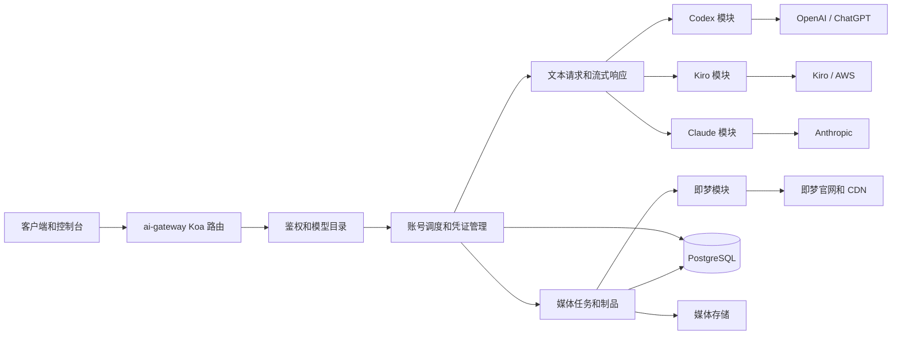

# ai-gateway 内置供应商反代架构

## 1. 产品与部署

**ai-gateway 是一个模块化反代应用。** 用户在控制台添加供应商账号、为调用 Key 选择产品并签发，然后通过标准协议调用模型。首发包含即梦图片与视频、Codex Responses、Kiro Messages 和 Claude Messages。

应用采用 Node.js 24、TypeScript、Koa、React 和 PostgreSQL。以本地 `jimeng-api` 的原生实现作为第一个供应商模块，同进程加载 Codex、Kiro、Claude。各模块直接访问供应商上游。发布一份镜像、一个 HTTP 入口和一个应用进程。即梦所需的 Chromium 随镜像提供，API 和视频任务循环由同一入口管理。PostgreSQL 与媒体卷承担持久化。

首发从空库初始化，由部署者配置管理员用户名和密码。公开 API、控制台、账号与数据模型都以本文为契约。源码来源和许可证记录服务于后续更新与发布审查。



## 2. 源码调研

下表链接固定到此次审阅的提交。判断依据包括路由、运行时调用、授权和响应解析源码。各上游的真实账号调用留给实施验收。

| 项目 | 实际实现 | 在本项目中的用途 |
| --- | --- | --- |
| Sub2API，`81ce835` | 网关按客户端协议和账号平台分派。OpenAI 路径先做账号选择，考虑组、模型、能力、会话粘性、账号可用性和负载，再由服务选择 OAuth 或 API Key 的上游路径。凭证续期单独维护。 | 借鉴「路由 → 账号调度 → 取凭证 → 原生转发」和会话绑定。在新 PostgreSQL 模型中实现精简的池授权、账号调度和租约。 [路由][sub-routes] · [调度][sub-schedule] · [OpenAI 网关][sub-openai] · [续期][sub-refresh] |
| `xiangking/sub2api-kiro`，`9541e0e` | Kiro 平台分支进入 `GatewayService.forwardKiro`，调用包内 Kiro 客户端。Anthropic 请求转为 Kiro 请求，AWS EventStream 被解码后生成 Claude SSE，非流式路径收集结果。OAuth 服务与同一个账号体系配合。 | 原生 Kiro 调用链和功能覆盖参考。Go 的 Gin、仓储、服务注入和调度依赖使整段服务难以直接迁入 Node。 [Kiro 网关][xiang-gateway] · [客户端][xiang-client] · [解码][xiang-parser] · [OAuth][xiang-oauth] |
| `kobojp/sub2api-kiro`，`5b44a01` | 另一条 Kiro fork，提供独立的 Kiro runtime、请求 translator、token provider。运行时处理账号凭证、上游调用、映射、错误和流式转换。 | 对照 Kiro 长会话、token 失效、账号粘性、上游错误分类等边界。重点看测试输入与预期行为。 [运行时][kobo-runtime] · [转换][kobo-translator] · [凭证][kobo-token] |
| CLIProxyAPI，`47f18e4` | `ProviderExecutor` 定义普通请求、流式请求、续期等能力。Codex HTTP 和 WebSocket 执行器在同进程内运行。审阅版本把 HTTP 实现拆在 `codex_executor_execute.go`、`_stream.go`、`_auth.go`。 | 给 Codex 协议兼容和流式行为提供对照。新架构直接使用应用内凭证和运行时。 [执行接口][cpa-interface] · [HTTP][cpa-execute] · [SSE][cpa-stream] · [续期][cpa-auth] · [WebSocket][cpa-ws] |
| `xwteam/kiro2api`，`124b14b` | Rust 运行时调用 Kiro，拆分 credential、refresh、provider、wire、AWS EventStream 和各客户端协议输出。流式与非流式共享上游事件来源。 | 用来核对 EventStream 帧、错误帧、认证类型、流终止和协议转换。源码可作为测试场景来源，Node 部署无需 Rust 服务。 [上游调用][rust-provider] · [解码器][rust-events] · [Anthropic 输出][rust-anthropic] |
| `krisamin/kiro-api`，`46c9f08` | TypeScript 实现。先构造 Kiro 请求，再由 HTTP 客户端读取 AWS 二进制事件并输出 Anthropic JSON/SSE。原项目的认证以 Bun SQLite 中的本地 Kiro CLI 账号为基础。 | **Kiro 首选的同语言代码来源。** 迁入解码、请求构造、事件转换和相关用例，把本地账号读取换成网关选定账号的凭证。 [解码器][ts-kiro-events] · [请求][ts-kiro-payload] · [HTTP][ts-kiro-client] · [输出][ts-kiro-stream] · [原认证][ts-kiro-auth] |
| `EvanZhouDev/openai-oauth`，`9079e62` | TypeScript 的 `@openai-oauth/core` 导出 OAuth 授权请求、交换、续期和进程内 transport。上层 Responses handler 调用 transport。该 handler 明确拒绝其无状态模式无法处理的服务器侧续接。 | **Codex 首选的同语言代码来源。** 按锁定提交纳入 core 源码。HTTP handler 只作对照。 [进程内 transport][oauth-runtime] · [SSE][oauth-sse] · [Responses handler][oauth-handler] · [包定义][oauth-package] |
| Pi，`ede8bdc` | TypeScript 中将 Codex OAuth 与 Responses 请求实现分开，后者还包含其 SDK 的模型和事件抽象。 | 对照 OAuth 流程和 Responses 特例。首版保持代理层面向客户端的原协议和完整字段。 [OAuth][pi-auth] · [Responses][pi-responses] |

## 3. 源码迁入清单

| 模块 | 迁入源文件或目录 | 接入工作 |
| --- | --- | --- |
| 即梦核心 | 本地 `jimeng-api` 的 `src/api/controllers/{core,models,images,image-size,videos,video-size,video-generation-task,video-tasks,video-history,video-task-progress,video-recast,generation-credits}.ts`，对应 images/video/model 路由，`src/lib/{image-reference,browser-transport,media-url}.ts` | 保留上游请求构造、模型映射、素材处理、积分流程、历史解析和浏览器生命周期。把 SQLite、模块级账号选择、设置和日志依赖接到网关。基线为本地 `jimeng-api` 的 `bf54a38451d18b80c66f1982590ef2f0a75b4c0a` 加已核对的工作树变更，包括图片编辑、尺寸、参考图校验和视频尾斜杠修正。构建只读取源码。 |
| Kiro 协议块 | `krisamin/kiro-api` 的 `src/kiro/{event-stream,type,convert,payload,client}.ts`、所需的 `thinking.ts` 和 `src/anthropic/{type,stream,response}.ts`，选取 `src/selftest.ts` 用例 | 解码器和无状态类型优先原样迁入。payload 的配置、模型能力和日志改由调用方提供。client 改成显式传入已选账号、凭证、发送函数和 `AbortSignal`。流式及 JSON 统一消费同一事件源。通过 Sub2API-Kiro 与 kiro2api 对照授权、区域和错误语义。 |
| Kiro 授权 | 参考两条 Sub2API-Kiro fork 的 OAuth，和 kiro2api 的 `kiro/login`、`credential.rs`、`refresh.rs` | 在统一凭证服务内实现授权回调、凭证导入和按类型续期。首版承诺经过验收的 Builder ID、IAM Identity Center 或 Social 类型，按能力逐个开放。批量导入读取用户指定的导出文件，正式服务从 PostgreSQL 获取授权账号。 |
| Codex | `openai-oauth/packages/core/src/{runtime,models,sse,utils}.ts` 及实际依赖，传输用例来自 `packages/core/test/transport.test.ts` | 迁入所需 TypeScript 模块和依赖，随网关构建。选中的账号每次显式传给 transport。持久化续期、租约、路由和用量归网关。路由级适配保留未知 JSON 字段、工具载荷和 SSE 输出。 |
| Claude | Anthropic Messages 官方契约和 CLIProxyAPI 原生转发作为实现参考 | 将 Console API Key 鉴权、版本和 beta 头、SSE、用量、`count_tokens` 能力按 Anthropic Messages 协议重新实现为 TypeScript 模块。 |
| 网关通用能力 | 新实现 | 从新的产品流程设计鉴权、账号存储、目录、调度、任务、用量、控制台和构建。为新契约编写测试。 |

Kiro 来源项目还实现了自动裁剪历史、缓存用量估算和本机数据库依赖。第一版将真实用量与估算分开，请求超过出站大小上限时返回 HTTP 413。Kiro 的 EventStream 必须处理分片、帧长度、CRC、消息类型、异常帧及中途截断。解码失败对应明确的上游错误，不能把缺失终止帧的流记成成功。[Kiro 客户端][ts-kiro-client] · [EventStream 解码][ts-kiro-events] · [Rust 对照][rust-events]

### 源码来源和许可证

迁入清单应记录源仓库、完整提交、文件路径、原许可证及本地改动。即梦本地仓库的 `LICENSE` 是 GPL v3 文本，`package.json` 的元数据另写 ISC，发布前核对来源和相应声明。此次审阅的 Sub2API 和两条 Kiro fork 的 `LICENSE` 是 LGPL v3，CLIProxyAPI、kiro2api、kiro-api 和 Pi 是 MIT，openai-oauth core 是 Apache-2.0，并有 NOTICE。直接迁入时保留源码中的权利声明和对应许可证或 NOTICE。Sub2API 系列在此方案主要提供架构与行为参考。[Sub2API][sub-license] · [xiangking][xiang-license] · [kobojp][kobo-license] · [CLIProxyAPI][cpa-license] · [kiro2api][rust-license] · [kiro-api][ts-kiro-license] · [openai-oauth][oauth-license] · [Pi][pi-license]

## 4. 模块边界和运行规则

### 目录和依赖

```text
apps/
  server/            Koa 装配、配置、生命周期
  console/           React 控制台
packages/
  identity/          管理会话、调用 Key 与权限
  accounts/          产品账号、凭证、授权流程、调度和租约
  catalog/           模型发现、公开别名、操作和能力
  gateway/           文本调用编排、尝试记录与流生命周期
  media/             图片交付、视频任务、素材与制品授权
  providers/         注册表及按供应商划分的实现
  protocols/         Responses、Messages、Images、Videos 的边界类型与错误输出
  postgres/          连接池、SQL 初始化与各业务模块的仓储实现
  blob-store/        媒体文件写入和读取
```

目录表示责任边界，可先用工作区内的模块实现。服务入口负责组装依赖。HTTP 路由只处理输入、鉴权上下文与输出，业务用例对调用方和任务循环提供相同入口。业务模块拥有自己的仓储接口，PostgreSQL 层实现接口并统一管理连接。控制台使用管理 API。共享给前端的类型仅涵盖实际 API 契约。

供应商模块依赖协议边界类型和本次调用上下文，通过注入获得 HTTP 客户端、日志和取消信号。每个模块独立拥有上游认证、请求转换和响应解释。账号、SQL、Koa 和其他供应商实现留在各自边界，模块间通过公开入口交换数据。模块边界以目录和入口函数体现，自动依赖规则属于后续增强。

### 供应商契约

供应商入口绑定固定的供应商 ID、凭证种类、模型发现与适配器实现。有新供应商时增加其模块、注册及契约测试。

| 契约 | 责任 |
| --- | --- |
| 账号接入 | 验证用户提交的凭证，返回去敏账号信息。按受支持的授权类型提供授权与刷新操作，续期返回新凭证及过期时间，由账号模块落库。 |
| 模型发现 | 返回上游模型 ID、可执行操作、已知参数约束和能力来源。目录维护公开别名及可用账号关联。 |
| 文本执行 | 接收具体协议、上游模型、所选凭证及取消信号。返回 JSON 或流及已报告用量。原生同协议路径保留工具载荷及未知字段，Kiro 的 AWS 事件转换在适配器内完成。 |
| 媒体执行 | 提供图片生成、视频提交、查询、下载和复刻所需的能力。视频查询支持使用提交 ID 恢复，结果携带可用于交付的上游标识。 |
| 失败结果 | 使用明确的失败类型描述无效输入、过期凭证、限流、上游拒绝、传输中断或提交待确认。编排层依据失败类型、发送阶段和操作的幂等语义决定后续处理。 |

文本与媒体使用各自的契约。原生协议之间按实际需求实现转换。统一的部分是身份、授权、模型路由、调度、请求追踪和错误分类。

### 请求生命周期

1. **接入账号和模型。** 管理员选择供应商，提交凭证或完成授权。凭证服务加密落库并触发模型发现。模型目录在账号登记时发现并持久化。独立的周期目录刷新属于后续增强。路由基于请求操作与模型能力筛选。
2. **鉴权与调度。** 由调用 Key 确定操作权限和池范围。从支持该模型及参数的健康账号中选取可用租约。文本默认按容量和最近使用时间选择，显式续接和视频任务绑定原账号。账号分配事务结束后发送请求。
3. **凭证续期。** 每账号合并并发刷新，租约和版本比较保护 token 轮换。续期失败进入短时冷却，控制台显示冷却与到期状态。已被禁用的账号不会获得新执行租约。管理会话与调用 Key 分开验证，日志和控制台只展示去敏状态。
4. **文本执行。** 用同一个取消信号贯穿网络读取与写回。客户端断开时取消上游并释放租约。只有确认上游未收到请求或协议明确允许重试时才能重新执行。输出首字节后维持原执行尝试。SSE 按协议终止事件确定成功，截断和超时记录为中断。
5. **媒体执行。** 同步图片与异步视频共享输入素材校验和制品存储。视频任务先持久化任务、输入摘要、账号和提交 ID，再调用即梦。复刻先验证来源归属及原账号绑定。轮询和制品入库可重复执行，失败任务保留可向用户展示的状态。
6. **用量与诊断。** 请求 ID 关联账号、尝试与用量。真实报告与估算单独标记。指标关注首字节延迟、流中断、续期失败、任务积压及交付时间。日志省略 Cookie、token、授权码和媒体内容。

### 首发接口

采用客户端已有的标准协议路径作为新产品契约。模型 ID 使用 `provider/model` 命名，例如 `kiro/<model>` 与 `claude/<model>`，从同一个授权目录按操作取交集。

| 路径 | 行为 |
| --- | --- |
| `GET /v1/models` | 列出调用 Key 可用的模型及操作。控制台可展示画幅、数量、上传限制、时长、工具和流式等能力。 |
| `POST /v1/responses` | Codex OAuth 与 OpenAI API Key，按模型和凭证类型直连。首发验证 HTTP、SSE、非流式和工具回合。WebSocket 和服务器侧续接分别验收后开放。 |
| `POST /v1/messages`、`POST /v1/messages/count_tokens` | Kiro 与 Claude Messages。仅为实现并验收过计数的模型开放 count_tokens。 |
| `POST /v1/images/generations`、`POST /v1/images/edits` | 同步图片生成和参考图编辑，按模型验证输入，支持 URL 或 Base64。 |
| `POST /v1/videos`、`GET /v1/videos/:id`、`GET /v1/videos/:id/content`、`POST /v1/videos/edits` | 即梦视频创建、查询、下载和复刻，视频 ID 和任务状态由新服务管理。 |
| `/admin/v1/*` | 新控制台管理产品账号、模型、调用 Key、请求记录和媒体。 |
| `/livez`、`/readyz` | 进程健康与本地依赖就绪。供应商账号的状态单独显示。 |

首发媒体有一个视频任务入口。控制台使用同一个领域服务生成和查询视频，相册读取同一批制品。图片采用同步的标准 API，后台任务循环专门处理已提交的视频恢复、轮询和交付。即梦聊天包装可继续参考本地源码，有需要时作为明确的新协议功能加入。

## 5. 新 PostgreSQL 数据模型

空库从 [initial.sql](../native/src/db/initial.sql) 初始化，版本记录在 `gateway_schema`。每个实例由一个管理员管理。调用权限由 API Key 的授权产品和操作决定。同一产品下的账号参与调度。媒体资源按调用 Key 归属。

| 表 | 职责与主要字段 |
| --- | --- |
| `admin_sessions` | 管理员用用户名和密码登录后建立限时 Cookie 会话。 |
| `api_keys` | Key 摘要、前缀、操作范围、到期、撤销和授权产品。 |
| `provider_accounts` | 账号通过 `provider` 区分产品。记录授权类型、凭证密文及版本、到期、冷却、启用状态和内部调度容量。 |
| `account_models` | 按账号保存公开模型 ID、上游模型 ID、操作和能力。 |
| `authorization_flows`、`account_leases` | OAuth 流程状态、加密 verifier、超时和一次性消费；账号并发及凭证刷新租约。 |
| `request_attempts` | 保存文本与图片的上游尝试、状态和可用的用量记录。视频生命周期由 `video_jobs` 记录。 |
| `video_jobs`、`media_assets` | 视频任务持有调用方、选定账号、幂等键及输入摘要、提交和历史 ID、状态、执行租约与下一次执行时间。制品记录对象 ID、归属、格式和大小。待提交视频参数和参考图加密保存于任务中。 |

数据库约束确保这些关联引用有效记录，视频的源任务和制品与其调用 Key 归属一致。视频幂等唯一键为 `(owner_id, operation, idempotency_key)`。同键同摘要返回原任务，同键不同摘要报冲突。调用前持久化提交 ID 和账号绑定，提交确认丢失时进入待确认并按原 ID 查询。数据库事务在出站 HTTP 前结束并释放连接，任务租约采用过期时间与版本校验。媒体文件存储在应用卷，数据库保存元数据与授权关系。

### 任务状态与存储一致性

正常路径为 `queued → submitting → in_progress → completed`，在最终完成前先写入影片及制品记录。读取不到提交确认时进入 `submission_unknown`，保持原账号及提交 ID 继续核对。明确失败进入 `failed`。视频取消 API 属于后续功能。任务领取与状态更新检查租约版本，进程重启后由任务循环继续推进。

制品先写入临时对象，校验后通过稳定对象键完成，再写入数据库引用。通过对象键和任务输出序号去重。原子写入在退出写入操作时清理临时文件。下载按调用方归属校验，图片 URL 可使用限时签名。定期扫描孤立文件属于后续增强。服务启动检查 SQL 版本和媒体卷，停止时先停止领任务、关闭新连接，再为现有流和任务提供限时收尾。

## 6. 从零实现顺序与验收

| 阶段 | 交付 | 验收 |
| --- | --- | --- |
| 1. 创建新应用和空库 | 新目录、依赖锁、Node 镜像、Koa 入口、初始 SQL、管理员初始化和测试基础设施 | 从空目录和空数据库启动，一个应用服务即可登录管理界面 |
| 2. 内置即梦 | 固化本地即梦源码快照，接入原生账号和模型目录，完成图片、视频、复刻、轮询与成品 | 对比直接运行原即梦源码和新应用的上游路径、模型请求键、生成参数、素材顺序和结果解析。重启后可继续查询已提交的视频 |
| 3. 内置 Codex 和 Claude | 接入 Codex OAuth transport 与续期、新建 Claude Messages 转发 | 用授权测试账号证实出站直达上游，覆盖 Responses、Messages、工具、普通 JSON、SSE、取消和报告用量 |
| 4. 内置 Kiro | 原生凭证、请求构造、二进制事件解码与 Messages 输出 | 按对外声明的授权类型验证，覆盖工具参数分段、非流式、异常帧、坏 CRC、截断流和续期并发 |
| 5. 新控制台和部署 | 实现产品账号管理、签发 Key、模型、请求和媒体页面，构建一份发布镜像 | 全新环境完成添加账号 → 选择产品并签发 Key → 调用四个供应商。验证产品授权、视频幂等、流取消及重启恢复 |

四个供应商的发布验收记录入站协议、账号类型、上游服务和响应类型。即梦对照测试对时间戳、请求 ID 和随机字段做归一化。媒体测试覆盖上游接收后提交响应丢失的恢复。部署验收确认应用镜像内只有一个产品服务入口，上游访问由该进程发起，配置只包含应用基础设施和供应商原生账号所需设置。

覆盖详情和发布验收边界见 [测试与发布验收](integration-validation.md)。

### 长期维护约束

- **按模块测试。** 协议编解码用固定载荷和分片测试，供应商用可注入 HTTP 替身跑契约测试，账号租约与视频幂等用真实 PostgreSQL 集成测试。发布验收覆盖授权账号直连和客户端行为。
- **按模块升级上游。** 为复用代码固定来源提交。同步时重跑对应适配器测试和协议契约测试。增加模型映射属于目录变更，增加上游协议只影响对应供应商与公开协议边界。
- **先保持单体。** 应用实例共用数据库和媒体存储即可扩容时，沿用现有事务与租约。出现独立扩缩需求后，可调整同一应用中的任务循环部署方式，共享模块契约。数据库和媒体权限保持同一个产品边界。
- **控制首发规模。** 先验证账号接入、签发 Key、直接调用、流式和视频交付。跨协议任意互转、支付、分布式缓存和独立进程调度按具体需要再增加。

[sub-routes]: https://github.com/Wei-Shaw/sub2api/blob/81ce8356d9a289411987bdefeddc9710340d6d52/backend/internal/server/routes/gateway.go
[sub-schedule]: https://github.com/Wei-Shaw/sub2api/blob/81ce8356d9a289411987bdefeddc9710340d6d52/backend/internal/service/openai_account_scheduler.go
[sub-openai]: https://github.com/Wei-Shaw/sub2api/blob/81ce8356d9a289411987bdefeddc9710340d6d52/backend/internal/service/openai_gateway_service.go
[sub-refresh]: https://github.com/Wei-Shaw/sub2api/blob/81ce8356d9a289411987bdefeddc9710340d6d52/backend/internal/service/token_refresh_service.go
[sub-license]: https://github.com/Wei-Shaw/sub2api/blob/81ce8356d9a289411987bdefeddc9710340d6d52/LICENSE
[xiang-gateway]: https://github.com/xiangking/sub2api-kiro/blob/9541e0e9fb64718c15581985c84807232536d39b/backend/internal/service/kiro_gateway.go
[xiang-client]: https://github.com/xiangking/sub2api-kiro/blob/9541e0e9fb64718c15581985c84807232536d39b/backend/internal/pkg/kiro/client.go
[xiang-parser]: https://github.com/xiangking/sub2api-kiro/blob/9541e0e9fb64718c15581985c84807232536d39b/backend/internal/pkg/kiro/parse.go
[xiang-oauth]: https://github.com/xiangking/sub2api-kiro/blob/9541e0e9fb64718c15581985c84807232536d39b/backend/internal/service/kiro_oauth_service.go
[xiang-license]: https://github.com/xiangking/sub2api-kiro/blob/9541e0e9fb64718c15581985c84807232536d39b/LICENSE
[kobo-runtime]: https://github.com/kobojp/sub2api-kiro/blob/5b44a0110c9f846ee6ba2a467d540216244f6f20/backend/internal/service/kiro_runtime.go
[kobo-translator]: https://github.com/kobojp/sub2api-kiro/blob/5b44a0110c9f846ee6ba2a467d540216244f6f20/backend/internal/pkg/kiro/translator.go
[kobo-token]: https://github.com/kobojp/sub2api-kiro/blob/5b44a0110c9f846ee6ba2a467d540216244f6f20/backend/internal/service/kiro_token_provider.go
[kobo-license]: https://github.com/kobojp/sub2api-kiro/blob/5b44a0110c9f846ee6ba2a467d540216244f6f20/LICENSE
[cpa-interface]: https://github.com/router-for-me/CLIProxyAPI/blob/47f18e4d82bd72f7d2b5ecf5ede93e4837a4625e/sdk/cliproxy/auth/conductor.go
[cpa-execute]: https://github.com/router-for-me/CLIProxyAPI/blob/47f18e4d82bd72f7d2b5ecf5ede93e4837a4625e/internal/runtime/executor/codex_executor_execute.go
[cpa-stream]: https://github.com/router-for-me/CLIProxyAPI/blob/47f18e4d82bd72f7d2b5ecf5ede93e4837a4625e/internal/runtime/executor/codex_executor_stream.go
[cpa-auth]: https://github.com/router-for-me/CLIProxyAPI/blob/47f18e4d82bd72f7d2b5ecf5ede93e4837a4625e/internal/runtime/executor/codex_executor_auth.go
[cpa-ws]: https://github.com/router-for-me/CLIProxyAPI/blob/47f18e4d82bd72f7d2b5ecf5ede93e4837a4625e/internal/runtime/executor/codex_websockets_executor.go
[cpa-license]: https://github.com/router-for-me/CLIProxyAPI/blob/47f18e4d82bd72f7d2b5ecf5ede93e4837a4625e/LICENSE
[rust-provider]: https://github.com/xwteam/kiro2api/blob/124b14b4327d16148170c06af0161a615a6f0c0e/src/kiro/provider.rs
[rust-events]: https://github.com/xwteam/kiro2api/blob/124b14b4327d16148170c06af0161a615a6f0c0e/src/kiro/eventstream/decoder.rs
[rust-anthropic]: https://github.com/xwteam/kiro2api/blob/124b14b4327d16148170c06af0161a615a6f0c0e/src/protocol/anthropic/stream.rs
[rust-license]: https://github.com/xwteam/kiro2api/blob/124b14b4327d16148170c06af0161a615a6f0c0e/LICENSE
[ts-kiro-events]: https://github.com/krisamin/kiro-api/blob/46c9f086d8b6d04932f829d80ef76afae3c8dcac/src/kiro/event-stream.ts
[ts-kiro-payload]: https://github.com/krisamin/kiro-api/blob/46c9f086d8b6d04932f829d80ef76afae3c8dcac/src/kiro/payload.ts
[ts-kiro-client]: https://github.com/krisamin/kiro-api/blob/46c9f086d8b6d04932f829d80ef76afae3c8dcac/src/kiro/client.ts
[ts-kiro-stream]: https://github.com/krisamin/kiro-api/blob/46c9f086d8b6d04932f829d80ef76afae3c8dcac/src/anthropic/stream.ts
[ts-kiro-auth]: https://github.com/krisamin/kiro-api/blob/46c9f086d8b6d04932f829d80ef76afae3c8dcac/src/kiro/auth.ts
[ts-kiro-license]: https://github.com/krisamin/kiro-api/blob/46c9f086d8b6d04932f829d80ef76afae3c8dcac/LICENSE
[oauth-runtime]: https://github.com/EvanZhouDev/openai-oauth/blob/9079e62840a7f4b19114cb8f4bb0009b5bcf1773/packages/core/src/runtime.ts
[oauth-sse]: https://github.com/EvanZhouDev/openai-oauth/blob/9079e62840a7f4b19114cb8f4bb0009b5bcf1773/packages/core/src/sse.ts
[oauth-handler]: https://github.com/EvanZhouDev/openai-oauth/blob/9079e62840a7f4b19114cb8f4bb0009b5bcf1773/packages/openai-oauth/src/responses.ts
[oauth-package]: https://github.com/EvanZhouDev/openai-oauth/blob/9079e62840a7f4b19114cb8f4bb0009b5bcf1773/packages/core/package.json
[oauth-license]: https://github.com/EvanZhouDev/openai-oauth/blob/9079e62840a7f4b19114cb8f4bb0009b5bcf1773/packages/core/LICENSE
[pi-auth]: https://github.com/earendil-works/pi/blob/ede8bdca0b76dba9e0dc77376318cc3479ba8142/packages/ai/src/auth/oauth/openai-codex.ts
[pi-responses]: https://github.com/earendil-works/pi/blob/ede8bdca0b76dba9e0dc77376318cc3479ba8142/packages/ai/src/api/openai-codex-responses.ts
[pi-license]: https://github.com/earendil-works/pi/blob/ede8bdca0b76dba9e0dc77376318cc3479ba8142/LICENSE
